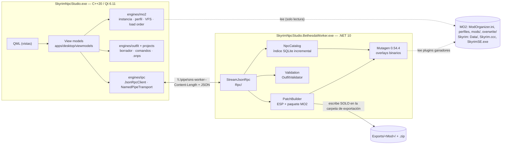

# Arquitectura

Skyrim NPC Studio son **dos procesos** que hablan JSON-RPC 2.0 sobre un *named pipe* de Windows:

## Reparto de responsabilidades

| Capa | Dónde | Hace | No hace |
|---|---|---|---|
| Vistas | `apps/desktop/qml` | Presentación, atajos, diálogos | Leer/escribir archivos, plugins o NIF |
| View models | `apps/desktop/viewmodels` | Estado de UI, orquestación, hilos | Lógica de formato Bethesda |
| `engines/mo2` | C++ sin Qt | Instancias, INI de QSettings, `modlist`/`plugins`/`loadorder`, VFS, cabeceras TES4, idioma | Interpretar registros |
| `engines/ipc` | C++ sin Qt | Framing, cliente JSON-RPC, transporte overlapped, lanzamiento con Job Object | — |
| `engines/projects`, `engines/outfit` | C++ sin Qt | `.snps`, `CommandStack`, `OutfitDraft` | — |
| Worker | .NET 10 | Lectura de plugins (Mutagen), índice, validación de registros, escritura del ESP, empaquetado | Saber qué es MO2 |

**Decisión clave:** el worker no conoce MO2. El motor C++ resuelve el perfil a una lista de plugins con la ruta absoluta del archivo **ganador** y se la envía en `catalog.index`. Hay una única implementación de la lógica de prioridades de MO2, y el worker se prueba con fixtures sintéticos sin necesitar una instancia (ver [ADR 0001](ADR/0001-two-process-architecture.md)).

**Los motores no dependen de Qt** ([ADR 0002](ADR/0002-engines-without-qt.md)): compilan y se prueban sin el SDK de Qt (`cmake --preset engines`), y los view models los envuelven.

## Protocolo

- JSON-RPC 2.0, *framing* `Content-Length: N\r\n\r\n` (igual que LSP), UTF-8. Cliente: `engines/ipc`. Servidor: StreamJsonRpc + `SystemTextJsonFormatter`.
- Parámetros siempre como **un objeto** (DTO tipado, `camelCase`). Contratos: [`services/BethesdaWorker/Contracts`](../services/BethesdaWorker/Contracts) ↔ [`engines/ipc/include/sns/ipc/protocol.hpp`](../engines/ipc/include/sns/ipc/protocol.hpp).
- Versionado: `system.handshake` compara la versión **mayor**; un cambio incompatible sube la mayor y el handshake falla con `1001 ProtocolMismatch`.
- Cancelación: notificación `$/cancelRequest {id}` → el servidor cancela el `CancellationToken` y responde `-32800`. Los *timeouts* del cliente envían esa cancelación y fallan con un código local (`-1`).
- Progreso: notificación `catalog.progress {stage, current, total, plugin}`.
- Códigos de aplicación en **1001–1099**, fuera de −32768..−32000: StreamJsonRpc ya usa −32000..−32004 ([ADR 0005](ADR/0005-error-codes.md)).

| Método | Uso |
|---|---|
| `system.handshake`, `system.ping`, `system.shutdown` | Ciclo de vida |
| `catalog.index` | Índice incremental de un load order (`plugins[]` con rutas, `language`, `cacheDirectory`) |
| `catalog.status`, `catalog.listPlugins` | Estado, plugins con prefijo de FormID y recuentos |
| `catalog.searchNpcs`, `catalog.getNpc` | Explorador y ficha de NPC (overrides, conflictos, FaceGen) |
| `catalog.searchArmors` | Catálogo de ropa/armaduras |
| `catalog.getAppearance` | Protocolo 1.1: NPC ganador, raza, cuerpo/ARMA, esqueleto, FaceGen y piezas del borrador |
| `outfit.validate` | Slots, razas/ARMA, plantillas, piezas inexistentes |
| `export.outfitPatch` | Modo A: ESP + carpeta MO2 + ZIP, atómico |

## Seguridad del canal

- Nombre de pipe impredecible (`sns-worker-<pid>-<aleatorio>`), creado con `PipeOptions.CurrentUserOnly`.
- El cliente verifica con `GetNamedPipeServerProcessId` que el dueño del pipe es el proceso que lanzó (evita *pipe squatting*).
- El worker se lanza en un **Job Object** con `KILL_ON_JOB_CLOSE` (tests) o vigila el PID del estudio (`--parent-pid`), así nunca queda huérfano con archivos abiertos.
- Límites: cabeceras de mensaje ≤ 8 KiB, mensajes ≤ 64 MiB, cabeceras TES4 ≤ 1 MiB, archivos de texto ≤ 32 MiB; rutas de perfil y nombres de plugin validados contra *path traversal*.

## Hilos

- La UI nunca bloquea: el escaneo del VFS corre en `QThreadPool`; cada llamada al worker corre en un pool propio de `WorkerClient` y el resultado vuelve al hilo de UI con `QMetaObject::invokeMethod(..., Qt::QueuedConnection)`, solo si el objeto de contexto sigue vivo.
- Las búsquedas usan un número de serie: una respuesta que llega tarde no pisa una búsqueda más reciente.
- En el worker, SQLite y los overlays de Mutagen no son *thread-safe*: todo acceso pasa por `WorkerState` (lock), y durante la indexación las lecturas fallan rápido con `1007 Busy`.

## Modelo de comandos

Toda modificación del usuario es un `sns::projects::Command` (`apply`/`revert`/`description`) en un `CommandStack` con límite, rama de *redo* y marca de "guardado". El editor de atuendos usa `make_add_piece`/`make_remove_piece`/`make_set_pieces`; deshacer/rehacer y el historial salen de ahí. La UI no muta el borrador directamente.

## Datos y caché

- Índice por perfil: `%LOCALAPPDATA%\SkyrimNpcStudio\SkyrimNpcStudio\cache\<perfil>\catalog.sqlite` (WAL).
- Cada plugin se identifica por una **firma**: ruta + tamaño + mtime + estilos ESL/ESM de sus masters + idioma + versión del extractor. Si no cambia, sus filas se reutilizan; los ganadores se recalculan en SQL con `ROW_NUMBER() OVER (PARTITION BY form_key ORDER BY load_index DESC)`.
- Medido con un perfil real de 415 plugins: indexado completo 7,9 s; re-indexado incremental 1,4 s.

## Errores

- C++: `sns::Error` con `ErrorKind`; `ipc::RpcError` añade el código JSON-RPC y `data`.
- .NET: `WorkerException(code, message, issues)` → `LocalRpcException` con `data.issues`.
- Los problemas de datos se devuelven como `Issue {severity, code, message, subject}`; una exportación con algún `error` se bloquea y no escribe nada.
