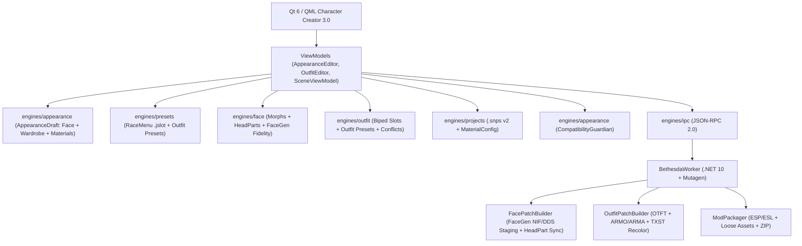

# Character Creator 3.0 — FaceGen Fidelity + Outfit Designer Plan

> **Goal:** Upgrade Skyrim NPC Studio Ultimate to **Character Creator 3.0**, adding real FaceGen fidelity & headpart synchronization, a 3D Outfit Designer with outfit presets & biped slot management, a Material & Texture Studio for armor recoloring with TXST/ARMA generation, BodySlide & body type detection, a unified Compatibility Guardian validator, and complete in-game mod packaging for Skyrim SE/AE.

---

## Architecture Overview

---

## Phased Implementation Roadmap

### Phase 1: Outfit Designer & Wardrobe Presets (`engines/outfit`, `engines/appearance`)
- [ ] Add `OutfitPreset` structure and library in `engines/outfit/` (`outfit_presets.hpp/cpp`).
- [ ] Expand biped slot mask utilities to check all 32 standard Skyrim armor slots (30..61).
- [ ] Add outfit preset save/apply commands to `AppearanceDraft`.
- [ ] Add unit tests for outfit presets and biped slot matrix in `tests/unit/engines/test_outfit_presets.cpp`.

### Phase 2: Material & Texture Studio (`engines/appearance`, `engines/projects`, `BethesdaWorker`)
- [ ] Add `PieceMaterialOverride` to `projects::Piece` and `projects::OutfitConfig` (custom tint color, texture set overrides, material name).
- [ ] In `OutfitPatchBuilder.cs`, when a piece has a material override:
  - Generate a new `TextureSet` (`TXST`) record.
  - Clone the `ArmorAddon` (`ARMA`) with the new `TextureSet`.
  - Clone the `Armor` (`ARMO`) with the new `ARMA`.
  - Assign the customized `ARMO` into the generated `OTFT` and inventory.
- [ ] Add xUnit tests in `tests/export/SkyrimNpcStudio.ExportTests/` verifying TXST/ARMA generation.

### Phase 3: FaceGen Fidelity & HeadPart Synchronization (`engines/face`, `BethesdaWorker`)
- [ ] In `FacePatchBuilder.cs`:
  - Enforce strict HeadPart synchronization: update target NPC `HeadParts` with winning donor/preset hair, eyes, brows, and head mesh FormKeys.
  - Prevent dark face bug: validate that FaceGen NIF and FaceTint DDS exist for the target NPC FormID and origin plugin.
  - When donor face is applied, rewrite internal FaceGen NIF header or verify block names with `nifly`/BethesdaWorker.
- [ ] In `AppearanceQueries.cs`, add deep headpart resolution (mesh paths, texture paths, part types).
- [ ] Add unit tests for FaceGen consistency and dark face prevention.

### Phase 4: Body Type & BodySlide Detection (`engines/rendering`, `BethesdaWorker`)
- [ ] Detect active body system in MO2 VFS: Vanilla, CBBE, 3BA/3BBB, UNP, HIMBO.
- [ ] Weight mesh interpolation verification (`_0.nif` / `_1.nif`).
- [ ] SMP/FSMP physics preservation flags in mesh loading and export.

### Phase 5: Compatibility Guardian Central Validator (`engines/appearance`, `BethesdaWorker`)
- [ ] Implement `CompatibilityGuardian` in `engines/appearance/` checking:
  - Face integrity: FaceGen NIF/DDS presence, HeadPart resolution, race/gender coherence.
  - Wardrobe integrity: ARMO/ARMA slots, sex model presence, missing textures.
  - Project integrity: ESL eligibility, master plugin order, conflicting overrides.
- [ ] Expose `diagnosticReport` with clear badges: `Verificado (Compatible)`, `Exportable con Advertencias`, `Error Bloqueante`.

### Phase 6: UI Character Creator 3.0 Suite (`apps/desktop/qml/charactercreator/`)
- [ ] `OutfitDesigner.qml`: Category filtering (Ligeras, Pesadas, Túnicas, Joyería, Botas, etc.) and Wardrobe Presets card gallery.
- [ ] `MaterialCustomizer.qml`: Armor piece recolor slider, texture finish options, live preview.
- [ ] `CompatibilityGuardianPanel.qml`: Live diagnostic check card with actionable fixes.
- [ ] Integrate into `CharacterCreator.qml` tabs.

### Phase 7: Verification & Build
- [ ] Run full CTest suite (Catch2).
- [ ] Run full .NET test suite (xUnit).
- [ ] Run `.\scripts\build.ps1` and verify Release packaging.
- [ ] Document all deliverables in `docs/DEVELOPMENT_PLAN.md` and report to user.
